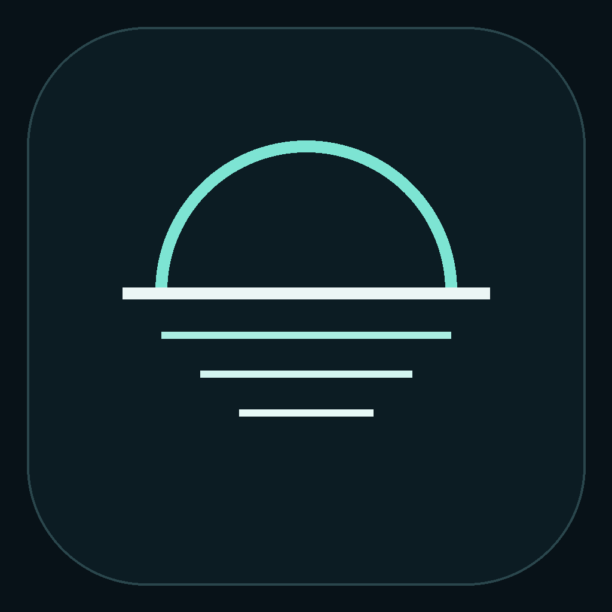
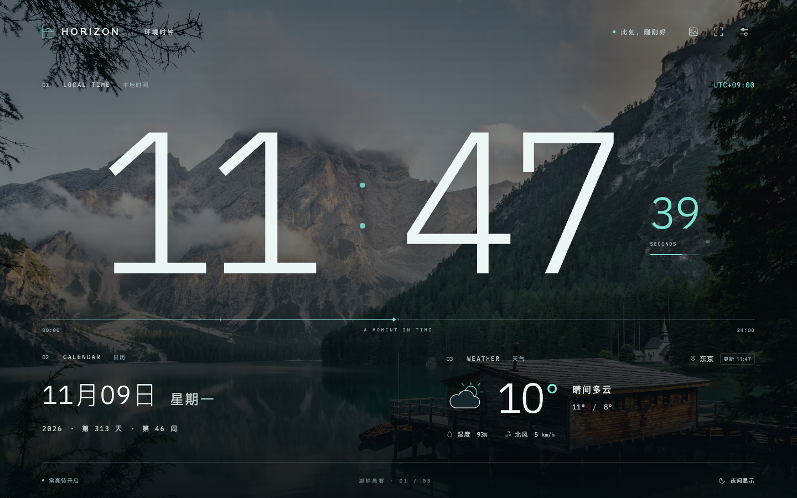

<p align="center"></p>
<h1 align="center">HORIZON · 环境时钟</h1>
<p align="center">把此刻，留在你的空间。<br>An open-source ambient wall clock for Omarchy and Linux tablets.</p>
<p align="center"><a href="https://github.com/Paige-BSG/horizon-clock/actions/workflows/checks.yml"></a> <a href="LICENSE"></a> </p>



HORIZON 把闲置平板变成客厅里的环境时钟：远处一眼看清时间，靠近时调整风景、天气与夜间显示。

**当前是 `0.2.0-alpha.2` 开发预览版。** 首个目标平台为 Omarchy 4.5 / x86_64，提供原生安装包，见 [下载安装说明](docs/INSTALL.md) 和 [GitHub Releases](https://github.com/Paige-BSG/horizon-clock/releases/tag/v0.2.0-alpha.2)。Omarchy 上已有原生功能验证；触屏、长期常亮和 72 小时验收仍待完成。当前没有自动安装更新的能力。

## 已有功能

- **简洁主屏**：右上角保留音乐、全屏、设置。进入「设置 → 背景 → 换背景」选图；导入、亮度和固定当前风景集中在同一面板。见 [快捷操作](docs/INTERACTION.md)。

- **清晰的时间与日期**：超大数字、秒数开关、星期与全天进度，使用设备本地时间。
- **21 张离线风景**：湖泊、雪山、森林、海岸、日落与阳朔峰林；淡入淡出、手动切换、背景压暗与纯色模式。
- **可选在线风景**：在「设置 → 背景 → 换背景」中开启一次，每天检查 Wikimedia Commons 精选风景，最多缓存 24 张，并保留昼夜当前选图。无需账号或 API 密钥；断网继续显示缓存，作者、许可与来源可在「设置 → 背景」查看。见 [风景图库](docs/GALLERY.md)。
- **当地天气**：默认开启，通过系统定位获取当地 Open-Meteo 天气，每 15 分钟刷新；定位失败可手动选城市，断网使用标明的缓存。
- **个人相册**：导入本机 JPG、PNG、WebP，调整构图、选择轮换照片；副本保存在设备上，重启恢复，移出不删除原文件。
- **昼夜独立显示**：默认开启 22:00–07:00 自动调暗；分别保存白天与夜间的信息亮度、背景压暗及风景/相册/纯色选择。自定义夜间时段，20 分钟渐进调暗/恢复；设置里可预览，关闭即恢复当前时段。
- **完整设置**：打开即显示时钟，无首次引导；三种环境色、设置迁移、JSON 备份和导入。
- **桌面集成**：Tauri 应用，原生全屏、用户自选登录启动、应用存续期间的系统唤醒请求；退出后释放。
- **网易云音乐（源码开发版，尚未发布）**：主屏音符按钮展开左右分栏，左侧显示歌曲、真实声纹和固定播放控制，右侧保留大时钟、日期与天气。支持列表/单曲循环、整份歌单随机和随心听；歌单按需展开，账号在「设置 → 应用」管理，启动不自动播放。需桌面版及本机 mpv。已发布 alpha.2 不包含此功能。见 [音乐](docs/MUSIC.md)。
- **版本检查**：用户主动检查 GitHub 正式版本信息；不下载或执行更新。

## 本地预览

需要 Node.js 22 或更新版本：

```sh
git clone https://github.com/Paige-BSG/horizon-clock.git
cd horizon-clock
npm ci
npm run dev
```

打开 <http://127.0.0.1:5173>。字体、图标和风景均已包含。不启用天气、在线风景，不使用网易云且不检查版本时，应用无需访问外网。主动点击照片来源/许可链接会打开对应网站。

快捷键：`F` 全屏、`N` 夜间、`B` 换景、`M` 音乐、`S` 设置、`Esc` 收起播放器/关闭设置/退出全屏。无操作 8 秒后工具栏隐藏，触摸、鼠标或键盘操作后恢复；音乐模式的控制始终可用。

## Omarchy 桌面版

**普通用户：** 下载 `.pkg.tar.zst` 安装包，校验后用 `sudo pacman -U ./文件名.pkg.tar.zst` 安装，无需 Node.js 或 Rust。完整步骤、旧源码安装迁移及卸载见 **[下载安装说明](docs/INSTALL.md)**。

**开发者源码构建：** 见 **[开发与安装说明](docs/DEVELOPMENT.md)**。准备 Rust 和 Tauri Linux 系统依赖后：

```sh
npm ci
npm run desktop:build -- --no-bundle
bash scripts/install-linux.sh
```

应用安装到当前用户目录，并创建启动图标。登录自启动和常亮在应用内选择。卸载脚本保留个人设置。源代码构建和 Linux CI 通过，均不能替代 Omarchy / Wayland 的实际运行验收。

相册与昼夜设置的操作方式及存储边界见 [个性化显示](docs/PERSONALIZATION.md)。

## 项目方向

第一版围绕“一块能够长期挂墙的时钟”完善安装、昼夜体验、离线恢复、维护和更新。保留已确认的视觉设计，先把 Omarchy 做好。

- [产品定义与验收标准](docs/PRODUCT.md)
- [路线图与尚未完成的发行门槛](ROADMAP.md)
- [架构与依赖选择](docs/ARCHITECTURE.md)
- [验证记录与实机检查](docs/VALIDATION.md)
- [参与贡献](CONTRIBUTING.md) · [安全与隐私](SECURITY.md)

## 开源许可与数据来源

原创代码、界面和应用图标采用 **[MIT](LICENSE)**。字体采用 SIL OFL；风景照片分别采用 Unsplash License、CC BY 4.0 或 CC BY-SA 4.0，逐张保留作者、授权与来源，不能按 MIT 重新授权。详见 [第三方声明](THIRD_PARTY_NOTICES.md)。

天气来自 [Open-Meteo](https://open-meteo.com/)，数据为模型估算，采用 CC BY 4.0。其免费托管接口限个人及非商业使用；商用采用者需自行取得合适的服务授权。天气默认使用系统定位；发送给天气服务的坐标保留两位小数，不请求高精度定位。定位权限受系统或浏览器控制，也可在设置中关闭天气或手动选城市。没有账号、统计分析或遥测。

## English

HORIZON is a local-first ambient clock for a wall-mounted tablet. It combines large readable time, bundled landscape backgrounds, system-location weather enabled by default, scheduled night dimming, settings backup, and a Tauri desktop application. Omarchy 4.5 is the first qualification target.

This is an **alpha**, not a qualified appliance release. An x86_64 Omarchy package and [installation instructions](docs/INSTALL.md) are available. Native build success and browser regressions are recorded separately from Omarchy runtime, physical readability and the required 72-hour soak test. For development, start with `npm ci && npm run dev`; native build instructions and release gates are linked above. Original code is MIT; bundled fonts/photos and the optional weather service have separate licenses and terms.
