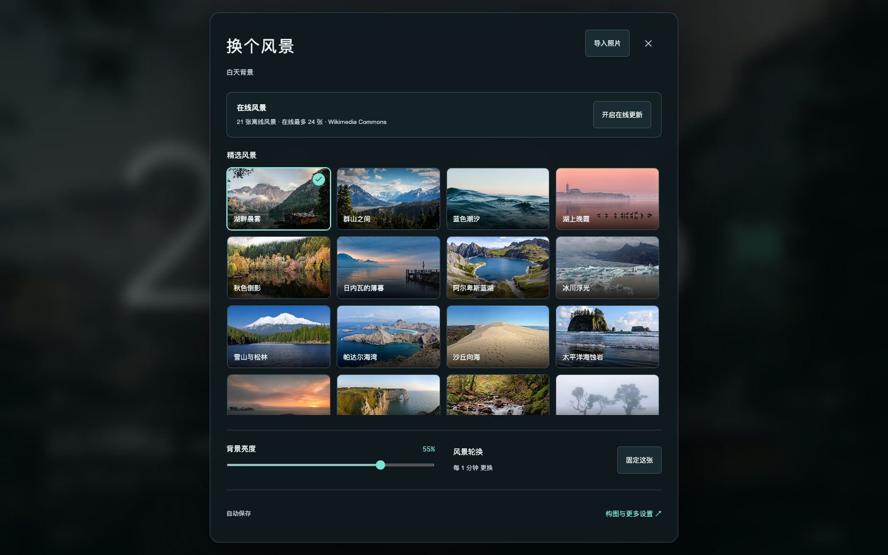

# 免费风景，自动更新

进入「设置 → 背景 → 换背景」即可使用 21 张内置风景，无需自己的照片，也无需联网。新选的 18 张图包含湖泊、森林、雪山、海岸、日落和阳朔峰林。其 JPEG 背景和缩略图约增加 12 MiB 资源。

想持续补充风景，在面板中点击一次「开启在线更新」。应用每天检查 Wikimedia Commons 的精选风景目录，优先取最近加入目录的图片；只接收横向 JPEG 和已识别的免费许可。每天检查不表示每天一定有新照片。成功下载后自动加入「精选风景」；原有轮换开关、昼夜设置和亮度继续生效。无需账号、API 密钥或订阅。

- 每次最多缓存 24 张；仍被白天或夜间选中的旧照片另外保留，最多 2 张。
- 同一批照片没有变化时复用本地副本。新下载失败、超时或保存失败，保留原有图库与显示。
- 断网可以继续使用内置图片和已缓存图片。原生版的页面资源随应用安装；浏览器预览仍需本机预览服务运行。
- 应用可见时自动检查；隐藏时停止请求，恢复显示后按更新间隔继续。失败后约一小时重试，也可点击「立即检查」。连续请求至少间隔一分钟。
- 「停止在线更新」会终止请求和后续检查，已下载图片仍可继续使用。在线缓存上限 96 MiB，与个人相册独立。每张网络图片最多下载 4 MiB，最多同时下载 3 张，整批请求有 45 秒超时。

联网时仅请求公共目录、照片与许可元数据，不发送自己的照片、天气城市或 GPS，不使用账号、Cookie 或 API 密钥。Wikimedia 仍可看到请求 IP。默认关闭；导入设置不会替你开启。设置 JSON 不包含图片字节，换设备后的在线缓存需重新获取。

## 作者和许可

时钟底部显示当前照片的作者与许可，点击可查看原图来源、作者和完整许可链接。原生版通过系统默认浏览器打开。在线图片的署名和许可随本地副本保存，离线仍可查看文字信息；外部网页本身需要联网。

新增内置图片逐张列在 [Commons 来源清单](../assets/landscapes/commons/CREDITS.md)，使用 CC BY 4.0 或 CC BY-SA 4.0。原有三张图片使用 [Unsplash License](../assets/landscapes/CREDITS.md)。图片与代码许可不同；复用图片时须保留对应作者、来源、许可和变更说明。在线接收的许可还可包含 CC BY/CC BY-SA 3.0、CC0 和公共领域。

Commons 允许按各图片许可复用，要求由单张图片的许可决定，见 [官方复用说明](https://commons.wikimedia.org/wiki/Commons:Reusing_content_outside_Wikimedia)。应用只缩放 JPEG 副本，并按屏幕裁切显示，不把第三方照片重新授权为 MIT。

