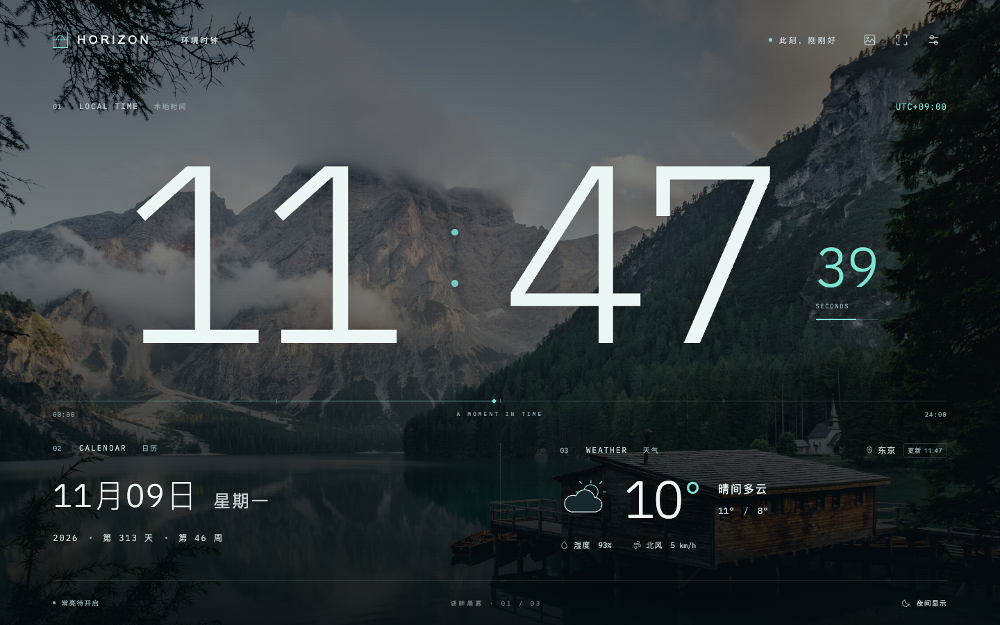
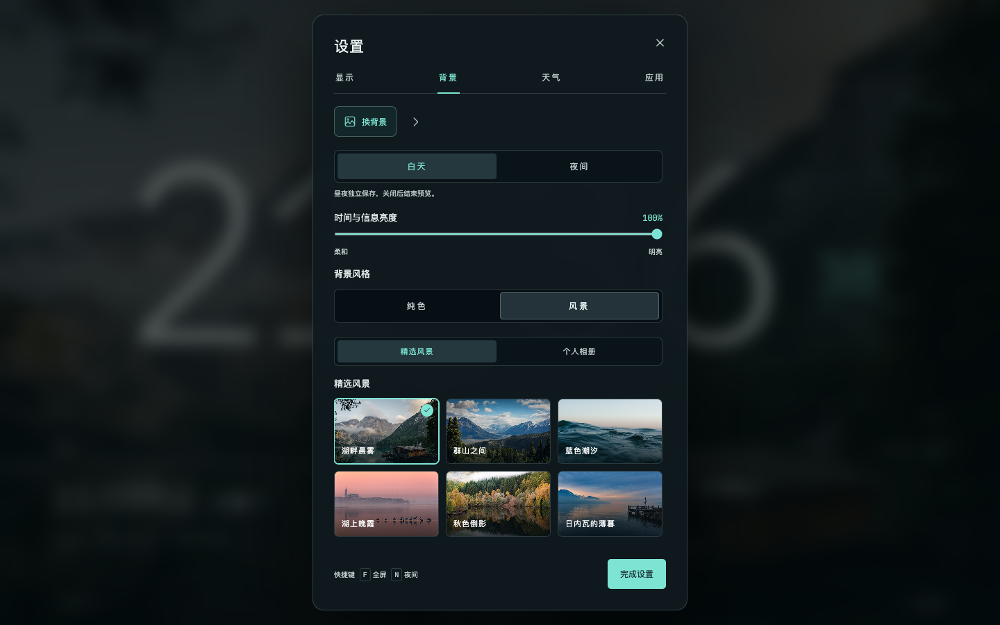
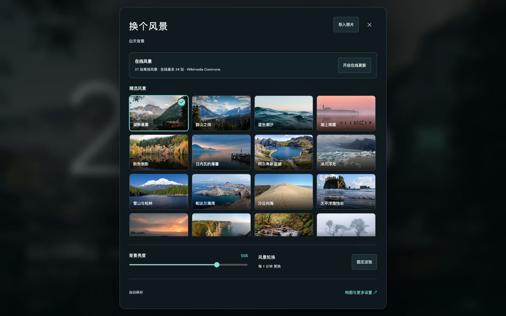
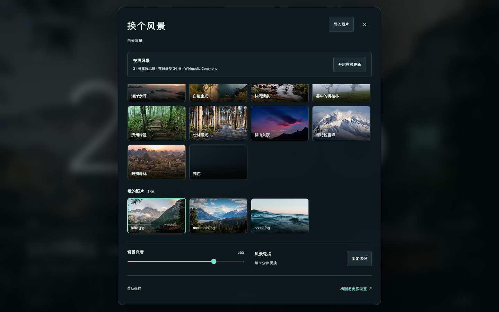

# 背景与常用操作

主屏右上角保留音乐、全屏、设置三个按钮。背景操作集中在「设置 → 背景」；「换背景」打开图库，旁边的箭头或 `B` 快捷键切换下一张。

主屏和音乐面板不显示底部状态栏。常亮状态、昼夜切换和声纹开关位于「设置 → 显示」；当前背景名称、序号、作者与授权位于「设置 → 背景」；电台来源位于「设置 → 应用」。背景信息卡可打开完整来源与许可，纯色背景不显示该卡片。`N` 快捷键继续切换昼夜。

图库提供 21 张离线风景、纯色和个人照片。点选后返回时钟并自动保存。导入照片、背景亮度与固定当前风景保留在图库面板；「构图与更多设置」返回背景设置。

## 在线风景

在「设置 → 背景 → 换背景」中开启「在线更新」。开启后每天自动检查 Wikimedia Commons，最多缓存 24 张精选风景，另外保留仍被昼夜选中的旧图。停止更新后保留缓存；断网时继续使用已下载的图片。详见 [图库与来源](GALLERY.md)。

## 昼夜与相册

- 图库编辑当前真实昼夜时段，标题下方显示白天或夜间。背景设置中的昼夜按钮可分别预览和细调。
- 选图保留原有轮换开关；「固定这张」关闭昼夜共用的轮换。
- 导入成功后使用第一张新照片。取消或全部失败时保留原背景。
- 慢导入不会覆盖较新的明确选择；关闭并重新打开图库，也不会被旧导入结果关闭。
- 个人照片只存本机，移出不会删除原文件。选图不会开启天气、常亮或自启动。

无操作 8 秒后工具栏和鼠标指针自动隐藏。键盘焦点在工具栏时保留入口；图库关闭后焦点回到设置按钮。

## 预览与验证

运行 `npm run dev` 后在本地预览检查。浏览器回归覆盖设置入口、工具栏按钮、选图、导入、昼夜分组、在线缓存、断网恢复和小屏布局。

下列截图使用仓库内已有授权照片。它们是浏览器界面记录，不能替代 Omarchy 原生版或物理触屏验收。

