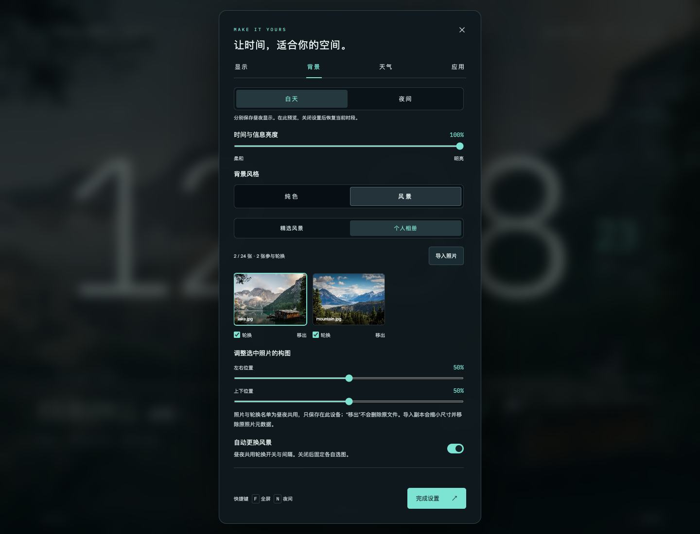
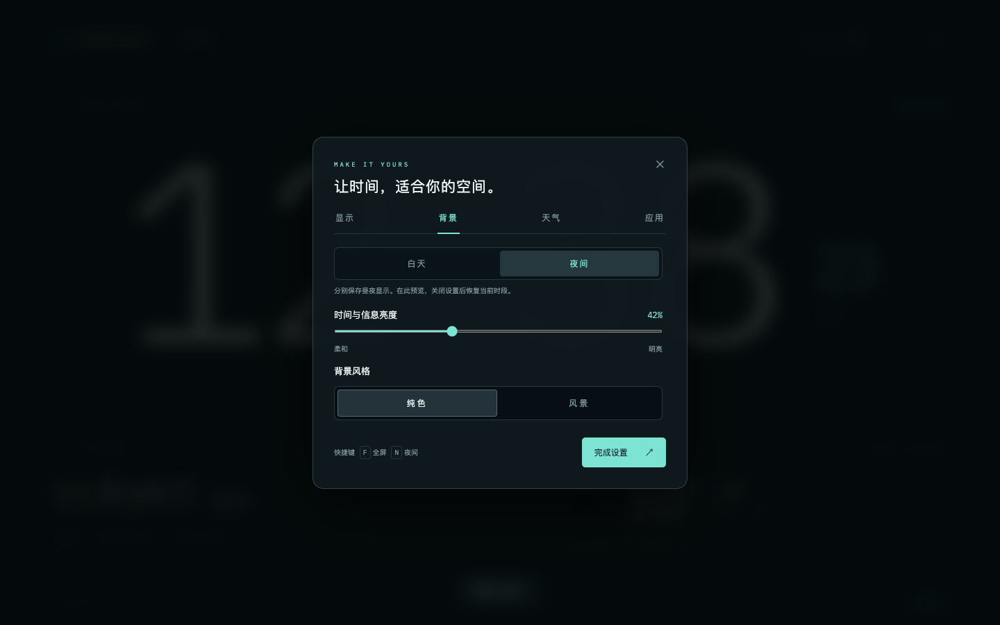

# 个人相册与昼夜显示

日常使用时，点击主屏「换背景」，点选风景或个人照片即可返回时钟。导入照片、背景亮度和固定当前风景也在此处；默认更改当前时段，自动保存。需要构图、轮换名单或其他细调时，点击「构图与更多设置」。详见 [快捷操作](INTERACTION.md)。

在完整设置中打开「背景」，可选择「白天」或「夜间」。两组设置分别保存；切换分组会临时预览该时段的效果，关闭设置后恢复真实时段。启用「显示 → 按时间自动调暗」后，应用按设备本地时间切换，并保留原有的渐进调暗与临时手动覆盖。

## 个人相册

1. 点击主屏「换背景 → 导入照片」，可以一次选择多张 JPG、PNG 或 WebP。第一张成功导入的新照片会直接用于当前时段；不需要先切到个人相册。
2. 点击照片预览；使用「左右位置」和「上下位置」调整画面裁切。照片构图会保存到相册条目，白天与夜间共用。
3. 勾选「轮换」决定哪些照片参加自动更换。轮换间隔与参与名单由相册共用；关闭自动更换即可固定当前图片。手动换图可以浏览未参与自动轮换的照片。
4. 点击「移出」删除设备内的相册副本，不会删除导入时的原始照片。

每个原文件上限为 20 MiB、4000 万像素；相册最多 24 张，总计 64 MiB。应用会把副本缩小到最长边 2560 像素并保存为 JPEG，同时生成小缩略图。副本移除原始照片元数据；原始文件完全保留。重复导入同一文件会跳过。超过容量、格式不支持或存储失败时会提示，不会伪装成导入成功。

图片与构图保存在本机应用/浏览器的数据中，重启可恢复；不会上传到天气服务或 GitHub。浏览器预览与桌面应用各有自己的存储，不共享相册。清除浏览器或应用数据会移除相册副本，因此应保留原始照片。

## 昼夜独立参数

- 「时间与信息亮度」控制时钟、日期、天气等界面的亮度。
- 「背景压暗」控制风景/相册上的遮罩。
- 白天和夜间可分别使用精选风景、个人相册或纯色。例如白天看旅行照片，夜间显示纯色和较暗的数字。
- 这是界面调暗，不是硬件背光控制。最终夜间效果仍需在实际平板上确认。

## 备份与升级

设置导出使用版本 2 格式，可恢复昼夜参数与照片选择引用；导入同时支持旧的版本 1 文件。设置文件不包含照片内容，换设备后需重新导入原始照片。相册中的照片按原文件内容识别，重新导入同一原文件时可以重新对应原有引用。

升级会继续使用既有的设置键和相册数据库。卸载脚本保留应用数据；卸载不等于照片备份。原有天气联网选择、常亮与自启动状态遵循本机设置边界。

上述相册截图使用仓库已有授权风景作为导入示例，来源见 [第三方声明](../THIRD_PARTY_NOTICES.md)。Omarchy 已安装构建的原生文件选择器和存储验证见 [验证记录](VALIDATION.md)。本次快捷面板尚未替换运行中的 72 小时观察构建。
