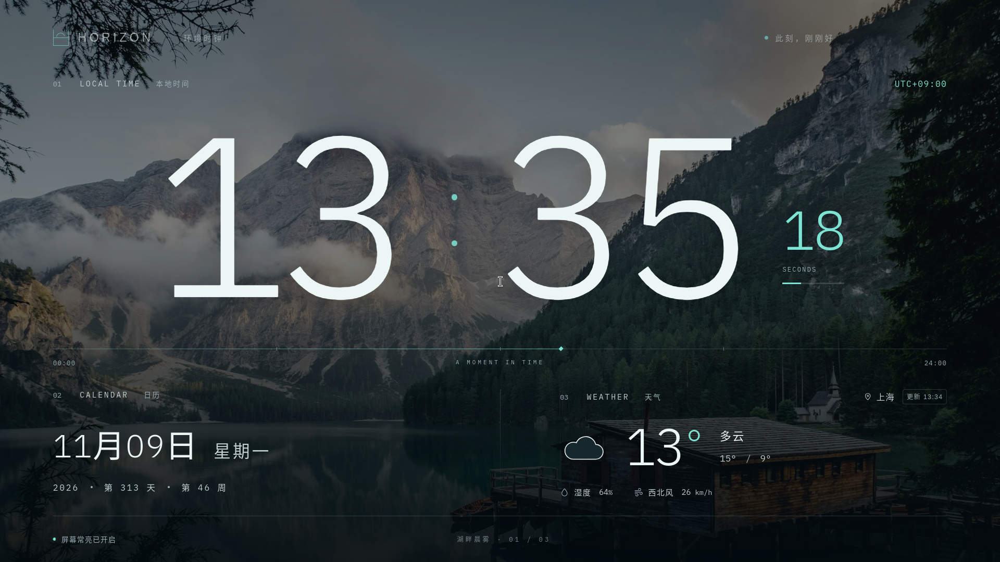

# Validation and acceptance

Validation layers are separate. A browser test or successful executable build does not prove Omarchy sleep behavior, physical readability or product acceptance.

Dated sections record the code and test counts at that time. MPRIS and Radio Paradise entries are historical; the current music implementation is native NetEase through mpv. Read the latest applicable section for current evidence. Earlier 32-test results do not describe the current 30-test Node suite.

## Direct startup and system weather — 2026-11-09

Fresh profiles open directly to the clock, with weather and the 22:00–07:00 automatic night schedule enabled. Weather defaults to the system geolocation API; manual cities remain available. Legacy onboarding flags are ignored. Existing explicit city and off-switch choices remain intact. Only rounded coordinates enter weather requests/local cache, and location is excluded from settings backups.

- `npm run check`: 32 Node tests and frontend build passed. The full browser suite passed all 67 tests using the installed Chrome channel. New coverage includes direct startup, real browser geolocation with test coordinates, permission denial, bounded unanswered prompts, late callback cancellation, moved-location cache isolation, offline last-position labeling and preserved off choices.
- A moved-position test initially exposed browser location-cache reuse. Requests now require a fresh position (`maximumAge: 0`), and the regression passes.
- Local macOS `cargo test --locked` passed seven checks; all-target clippy with warnings denied and Rust formatting passed. Permission handling permits geolocation only in the local main clock webview. No dependency or system package changes were needed.
- A fresh isolated browser profile with supplied Shanghai test coordinates obtained an actual Open-Meteo response. Both default switches were on and zero dialogs were open. `previews/startup-clock.png` and `previews/weather-location-settings.png` were visually inspected. The position was supplied by the test; this does not prove actual OS/device location acquisition.
- The native smoke script now checks direct startup and current local night state. It was updated but has not been rerun on Omarchy for this revision. Installed application and public package remain unchanged; native geolocation and system policy/provider behavior remain pending target-device validation.

## Current UI and expanded gallery — 2026-11-09

The main toolbar contains only music, fullscreen and settings. Background selection and next-image controls are in Settings → Background. Main-screen labels and settings copy are shorter. The gallery caches up to 24 online images plus up to two selected older images, with a 96 MiB storage bound and at most three concurrent downloads; network consent remains opt-in.

- `npm run check`: 28 Node tests and frontend build passed. Formatting and whitespace checks passed.
- With the repository-supported `PLAYWRIGHT_CHROMIUM_CHANNEL=chrome`, the full 59-test browser suite passed. The expanded 11-test gallery suite then passed, including two additional regressions for cache reuse and failed-image fallback/order. The default Playwright launch first failed because its bundled browser was absent; the installed Chrome required no dependency changes.
- A separate real-network browser check downloaded and cached 24 Wikimedia Commons images and showed 45 total landscapes with no failed requests. This is separate from mocked regression fixtures; availability and catalog contents can change.
- Desktop, settings, gallery and 390-pixel gallery screenshots were rendered and visually inspected. Updated documentation images are in `docs/images/`; local real-network evidence is `previews/live-online-gallery.png`.
- These changes are local source/browser validation. The installed Omarchy application and public alpha package have not been replaced by this task. Native webview, touch and human visual acceptance for this revision remain unverified.

## Local checks — 2026-11-09

| Layer                                        | Evidence / scope                                                                                                                                                                              |
| -------------------------------------------- | --------------------------------------------------------------------------------------------------------------------------------------------------------------------------------------------- |
| Unit regressions                             | `npm test`: 20 passing checks for settings validation/migration, backup boundaries, night schedules and overrides, weather parsing/units/expiry                                               |
| Browser regressions                          | `npm run test:e2e`: 42 passing browser regressions covering first-run consent, midnight/year rollover, backgrounds, weather failures/timeouts/cache, backup, updates and eight viewport sizes |
| Real weather request                         | An actual Open-Meteo response for Shanghai was retrieved and parsed successfully; this is separate from mocked weather regressions                                                            |
| Frontend distribution                        | `npm run build` produces the fixed asset set in `dist/`                                                                                                                                       |
| Native compilation                           | Local macOS ARM64 `cargo check` and application bundle build succeeded; not Linux runtime proof                                                                                               |
| Linux compilation/install                    | Automated by the public repository's **Checks** workflow; inspect its result for the relevant commit                                                                                          |
| Visual inspection                            | Current browser-rendered screenshots are under `docs/images/`; they do not establish distant viewing or hardware brightness acceptance                                                        |
| Omarchy physical qualification               | Pending                                                                                                                                                                                       |
| 72-hour soak and update/reinstall acceptance | Pending                                                                                                                                                                                       |

The local macOS release build emitted a Rust toolchain symbol-stripping warning (`rust-objcopy` could not load `libLLVM.dylib`). The build exited successfully and produced the application bundle. This does not establish native runtime behavior. `cargo check` and `cargo clippy -- -D warnings` passed.

## v0.2 personalization scope

Browser regressions include photo import, actual Chromium-process restart recovery, deduplication, framing persistence, participation, invalid/spoofed inputs, EXIF removal, unavailable storage, capacity limits, slow-image selection races and temporary day/night previews. Personalization screenshots use only the repository’s existing licensed landscapes as sample imports; no personal photos were published. Native picker, IndexedDB durability and initial resource observations are recorded below. Long-duration behavior remains pending.

## Physical-device checklist

Record OS/version, CPU architecture, compositor/session, application version and scaling. Avoid publishing private hostnames or network addresses.

1. Install from a clean user profile; complete first-run setup; verify launch icon, touch controls and fullscreen exit.
2. Compare actual wall/sofa readability by daylight, room light and darkness. Check weather/date contrast against all bundled landscapes.
3. Enable awake mode and verify both inhibitor state and actual display behavior over idle periods. Disable it and confirm release; exit and confirm normal OS policies resume.
4. Enable autostart and log out/in; reboot and distinguish disk/login authentication from application startup. Do not weaken authentication to pass this check.
5. Verify settings backup/import, persistence and recovery in the native webview.
6. Run offline with and without weather cache; restore connectivity; test a city change while offline. No old city or expired data may appear as current weather.
7. Run for 72 real hours, including midnight and night/day transitions. Record memory/CPU, display state, failures and restart behavior. Simulated clock tests are not the soak test.
8. Upgrade from the previous published version; retain settings; verify rollback/uninstall/reinstall. Keep personal settings unless deletion is separately requested.

Only after all release gates in [ROADMAP.md](../ROADMAP.md) pass should a version be described as the supported 1.0 product.

## Omarchy native session — 2026-11-09

Tested on Omarchy 4.5.0, x86_64, Hyprland 0.56.2 with its Lua configuration, GTK 3.24.52 and WebKitGTK 2.54.1. The built-in panel reports 1920 × 1080 at scale 1. This is a laptop panel; tablet touch and other panel/scaling combinations remain unqualified.

- A clean isolated native profile passed all 17 checks in `tests/native/smoke.mjs`: actual ticking/local time, offline first-run consent, onboarding persistence, native fullscreen entry/exit, night dimming, autostart toggle/readback/restoration, photo import/decode/render/deduplication/IndexedDB, saved framing, backup consent boundaries and a real Shanghai weather response.
- A complete native-process restart retained the selected imported photo, its JPEG bytes and 30% horizontal framing, settings, weather city and fullscreen startup.
- A separate keyboard interaction with the GTK file chooser imported the repository's `mountain.jpg`. Native settings export produced a valid schema-2 JSON file on disk; importing it through the OS chooser restored an altered theme. Only licensed repository photos were used.
- The original ScreenSaver D-Bus request reproduced `ServiceUnknown`. The Wayland implementation was checked against two live Quickshell `IdleMonitor` instances with five-second timeouts. Enabling inhibition resumed only the monitor that respected inhibitors; the input-only monitor stayed idle. Explicit disable and native window close released inhibition; the respecting monitor became idle again. The HORIZON logind `idle` handle appeared while enabled and disappeared after close.
- The desktop's existing global stay-awake setting was left unchanged. Consequently these checks prove the live compositor protocol and handle release, not the user's actual lock-screen timeout or lid/manual-suspend behavior.

The real user profile additionally passed all 18 native checks at WebKit device scale 1.3636 after fixing the viewport-unit mismatch. Logical viewport and content heights were both 792 CSS pixels, with no vertical overflow. The fix preserves the system text-scaling setting and uses logical webview dimensions for desktop viewport units. Browser coverage includes resize/fullscreen dimensions.

The normal installed build, long-duration observations and login-cycle results must be recorded separately. Exported JSON and screenshots do not qualify a binary release. No 72-hour result or human acceptance is implied by the checks above.

The normal build was installed, removed and reinstalled while retaining the application data directory, then launched through its installed desktop entry. Fullscreen, Shanghai weather, automatic night scheduling and awake mode recovered from the retained profile. The native autostart checkbox created an entry pointing at the installed executable; a full logout/login cycle remains pending. The normal process had no listener on the QA port. The original Pi console was retained and the temporary Herdr/Pi pane was closed.

## Quick daily controls — browser revision

The direct background picker retains all detailed settings and adds immediate scene selection, import-to-display, brightness and pinning. Local verification passed 14 Node checks and 33 browser regressions. The nine new regressions cover the two-click selection path, current day/night group, chooser-triggered import from solid color, cancellation/failure, quick controls and detailed settings, slow-import races, logical viewport containment and pointer/keyboard focus behavior. Desktop and narrow-screen screenshots were inspected; see [interaction paths](INTERACTION.md).

The native Omarchy results above apply to commit `c1fb704`. The new picker has not replaced that installed build or its ongoing 72-hour observation. Its native chooser/touch behavior remains to be checked after this observation.

## Free scenery and online gallery — 2026-11-09

The source revision adds 18 Commons backgrounds (21 bundled total), optional daily online checks, a separate bounded cache and photo-source attribution. All 18 downloaded JPEGs were decoded and inspected in a contact sheet. Desktop/mobile gallery screenshots and a Yangshuo clock display were rendered and visually reviewed. Small-screen attribution uses its own footer row to preserve the existing status/night labels.

- 20 Node checks and 42 browser regressions passed. The nine new browser checks cover no requests before consent, bundled scene/source selection, six-image downloads, cache persistence across reload and an actual browser-process restart with external requests blocked, daily refresh/order/selected-image retention, disabling and in-flight cancellation, failure retry, atomic cache-write failure and displayed-image attribution after failed replacement, and overlapping network-recovery notifications during a failed request. The latter race was reproduced as an unhandled fetch rejection and then fixed. The cache retry regression also covers a user-forced failure while the prior successful cache is less than a day old.
- A live Chromium run with the desktop CSP returned **two actual Commons API responses and six actual JPEG downloads**, with zero background requests before consent and no page errors. A downloaded cached image decoded and displayed successfully. This is separate from deterministic mocked provider tests.
- Read-only SSH requests from `aw-omarchy` returned HTTP 200 for Commons API reachability and one actual thumbnail URL. These are network reachability checks, not a new native application runtime test.
- Frontend build, formatting/whitespace, macOS locked native check/clippy and two Rust source-URL validation tests passed. Tauri opener is added for explicitly clicked photo/license links, with automatic JS link interception disabled and no broad frontend opener permission.
- Existing 72-hour observation and installed native commit `c1fb704` were left unchanged. New gallery behavior, external browser launch and online/cache requests in Linux WebKitGTK still need native verification after the observation. No qualified binary release is implied.

## Music controls — local revision, 2026-11-09

The optional inline music bar adds song/artist/status, play/pause, previous/next and explicit selection among multiple running MPRIS players. Login and content playback remain in the user's official player. No music credentials, audio URLs, artwork requests or settings-schema changes were introduced.

- 20 Node checks and 52 browser regressions passed with the installed Chrome channel. The ten new music checks use explicit test fixtures and cover target selection, capability limits, command failure, duplicate input, stale in-flight reads, process-owner changes, disconnect/recovery, hidden/closed polling, platform limitations, safe text rendering and viewport containment. These fixtures do not establish official-player compatibility.
- Six Rust tests passed on macOS. Four new tests exercise the Linux MPRIS backend with real local D-Bus messages against an isolated test service: discovery/metadata, Play/Pause/Previous/Next, capability enforcement, closed/replaced owners, restricted targets/actions and method timeout. They need no session bus daemon. The two existing photo-source tests remain passing.
- Frontend build, locked macOS desktop check, all-target Rust clippy with warnings denied, formatting and whitespace checks passed. The Linux workflow now includes the Rust tests; no remote CI run or Linux build result is claimed for this revision.
- Desktop and narrow-screen music layouts were rendered and visually inspected. Local `previews/music-connected-*.png` use visibly labeled sample track/player data; they are interface previews, not a successful NetEase connection or audio test. Expanding the bar reduces the time size to retain the date/weather; closing restores it. Music controls remain available while the toolbar hides on idle.
- A read-only check on the Omarchy target found Chromium available and no currently exported MPRIS players. The normal clock and its ongoing 72-hour observer were active. No player was installed or launched, no account was accessed, and the installed clock/observer were not restarted or replaced.

Remaining: compile and run this revision on Linux; verify the intended official NetEase client or official web player, supported controls, background playback and reconnection. Deployment must record any interrupted soak observation separately. See [music setup and limitations](MUSIC.md).

## Background transition correction — 2026-11-09

Normal-motion tests reproduced a coverage dip when both background layers faded simultaneously. Rapid requests could also reuse a still-visible layer. Both new regressions failed before the correction: sampled combined image opacity fell below full coverage, exposing the dark backdrop.

The outgoing image now stays fully opaque beneath the incoming fade. A subsequent request waits for the current fade to finish, then checks that it is still the latest selection before reusing the hidden layer. The contrast mask remains above both images. The initial image is decoded and displayed without a separate image-opacity fade; the existing backdrop entrance remains. Reduced-motion settings still skip transitions.

All 54 browser regressions, 20 Node checks, frontend build and formatting/whitespace checks passed locally. The two new checks exercise normal-motion mid-fade coverage and rapid selection. These results establish browser behavior; Omarchy/WebKit verification is recorded separately after deployment. Paige canceled the running 72-hour observation; it was stopped, its records retained, and no new observation is to be started without a new request.

## Omarchy music and transition checks — 2026-11-09

Source `b38bca8` passed all six Rust tests, Linux all-target clippy with warnings denied, and normal/QA native release builds on the target. An isolated QA profile passed 13 native checks at the existing 1.3636 device scale: actual session D-Bus discovery through Tauri IPC, displayed test metadata, Play/Pause/Previous/Next, rejected non-media and stale-owner requests, clock updates and connected music layout. The test service was explicitly labeled as a fixture and played no audio. Stopping it removed it from discovery and disabled its old controls. This does not qualify the intended official NetEase player.

Both actual WebKit transition checks retained minimum combined image coverage of 1.0 across 55 samples each, with motion enabled, including rapid requests. This verifies the reported dark-gap mechanism in the native engine; physical visual acceptance remains with the user.

The normal installed build restored full screen, Shanghai weather and awake inhibition. Its compositor screenshot exposed an additional empty-player layout overflow: 803 CSS pixels of content in the 792-pixel logical viewport. A new browser regression reproduced that exact overflow. Reducing the expanded music view's time-height limit from 30% to 28% restored 792-pixel containment in live WebKit QA style validation and in the browser regression, including desktop and narrow-screen empty states. The collapsed clock retains its original size.

The empty-state follow-up passed all 55 browser regressions, 20 Node checks, frontend build, formatting and whitespace checks.

The previous observation was canceled after 43 samples and 2522.2 seconds, with its log retained; this is not a 72-hour pass. No replacement observation is authorized. Native evidence remains in the private handoff evidence directory. The official NetEase web player was opened in an independent Chromium window, with the clock returned to the foreground; no account or real music playback was tested.

## Account-free network radio — local revision, 2026-11-09

Paige chose channel-based live music without local files, accounts or single-song requests. The radio bar uses the official Radio Paradise stream-links page's Mellow Mix, Serenity and Main Mix addresses, with verified HTTPS variants. The provider's current page explicitly presents these URLs for WiFi radios and other players. SomaFM was excluded after its current terms were checked; network reachability alone is not an embedding permission.

- 28 Node checks and all 52 browser regressions passed. Eight controller checks cover explicit playback intent, validated preferences, stream release, stale events, bounded retries, denied autoplay, buffering deadlines and repeated stall events. A full-run timeout regression exposed late buffering events extending the connection deadline; the deadline now remains fixed until playback starts, and a targeted regression preserves that behavior.
- Eight browser radio checks use generated silent PCM to exercise the real browser media element: no requests before Play, selection/volume persistence without autoplay, background playback while collapsed, stop/retry cancellation, slow responses, the actual desktop CSP, fixed source opening and empty/playing layout across seven sizes. These fixtures are distinct from live station verification.
- A live Chromium run decoded the real Mellow Mix MP3 stream with anonymous CORS and volume zero, reaching readyState3 and the Playing event. All three official stream endpoints returned audio and matching CORS headers from Omarchy (Mellow/Main MP3; Serenity AAC). This is not yet an installed WebKit decode result.
- Frontend build, formatting/whitespace, locked macOS native check, two existing Rust source-link tests and all-target clippy with warnings denied passed. Desktop/narrow-screen screenshots were visually reviewed. No production dependency was added; music's native MPRIS commands and their direct serde/dev-zbus requirements were removed. Existing zbus remains for Linux awake behavior.

Live Omarchy decoding, controls and final installation are recorded separately. The canceled 72-hour observer is to remain off.

## Linux audio prerequisite guard — 2026-11-09

The first real radio playback attempt exposed a missing system prerequisite: `autoaudiosink` was absent, and WebKit's media process terminated instead of returning a normal media error. The running installed clock was unaffected. With Paige's explicit approval, `gst-plugins-good` and `gst-libav`1.28.8-1 and seven missing dependencies were installed: nine new packages,4.27MiB downloaded,13.55MiB installed. No existing system packages were upgraded. Subsequent checks found automatic output, PulseAudio output, MP3 and AAC decoder elements.

The desktop radio bar now checks the fixed local audio-output element before enabling Play. The inspection runs off the UI thread, takes no frontend arguments and is killed after three seconds if it stalls. Failure disables audio creation and shows a component message; reopening rechecks availability. This keeps a missing optional audio runtime from taking down the clock. Browser preflight tests cover failure, no media request/element and successful recheck. All53browser checks and28Node checks passed, along with frontend build, formatting and macOS all-target clippy. Linux build and real-stream results remain separate.

## WebKit radio transport compatibility — 2026-11-09

After installing the audio components, WebKit reported that a provider302redirect lacked the CORS headers required by the explicit anonymous-crossorigin attribute. The final audio response did provide CORS headers, so an endpoint probe and Chromium playback alone did not expose this redirect-chain difference. Normal HTML media loading needs no cross-origin script access and follows the provider's redirect correctly; the explicit crossorigin attribute was removed. The no-referrer policy and provider-only media CSP remain. Provider service cookies are managed by the webview, not read or imported by the application.

Live QA transport validation reached Playing with real Mellow Mix audio at readyState4. A two-pixel native layout overflow was also corrected by reducing only the expanded music information padding. The equivalent live style validation fits792CSSpxat1.3636scale. All53browser regressions,28Node checks, frontend build and formatting passed with the transport correction. Per-channel native reports and the installed normal binary are separate evidence.

## Compact radio controls — 2026-11-09

The three channels are now directly visible buttons with a selected state. The dropdown, redundant next-channel button and persistent explanatory paragraph were removed. Play/stop, volume, brief playback status and the provider source remain. A short help line appears only for an error or a blocked playback gesture. Desktop uses one row; narrow screens use two compact rows without wrapping channel labels.

All53browser regressions,28Node checks, frontend build, formatting and whitespace checks passed. The updated nine radio regressions cover direct channel switching, three visible choices, absence of a dropdown or normal-state help, saved selection/volume, no autoplay, playback/recovery and seven viewport sizes. After a narrow-layout refinement, all nine radio checks passed again. Desktop and390pxscreenshots were visually inspected. Native deployment and live playback are recorded separately.

## Installed radio and compact controls — 2026-11-09

The normal Linux build from `fb66b25` compiled successfully and was atomically installed on Omarchy. Installed SHA256: `c9d4b263b0f91ba3f19c43558d49d58503e0a802114386e2a1956fa91d0594f3`. The previous `3b46887` normal binary remains available for rollback. No public push or release was performed.

In the actual installed app, keyboard activation started Mellow Mix and switched directly to Serenity and Main Mix. Each channel displayed Playing and had a matching running PipeWire audio-output node under the clock application. These are live network streams, not test fixtures. Stop removed the running clock audio node. This verifies the software playback/output path, not a human listening assessment of the speakers. The final screen is stopped on Mellow at30%appvolume.

Fresh1920×1080compositor screenshots were inspected for each live channel and the final stopped state. The compact single-row panel, clock, Shanghai weather, attribution and footer all fit the scaled full-screen display. The normal clock service remains active; no QA listener remains on4445. App data and system volume were preserved. Evidence is retained in the private handoff evidence directory.

## Split clock and measured waveform — 2026-11-09

Music mode now shares the main screen in a4:6player/information grid. The original time, date and weather remain visible and update in place; settings and display controls remain available. The final visual is a64pointmeasured waveform. Idle, stopped and muted states are straight lines, with no continuous idle drawing.

All59browser regressions and28Node tests passed, along with frontend build, formatting and whitespace checks. The15radio regressions include actual silent/tonal PCM decoding through Web Audio, energy variation, positive waveform samples, exact zero waveform when muted/stopped, idle redraw suspension, background playback, source opening, component preflight, logical viewport sizing and eight split-layout viewports. Six Rust tests passed on macOS and eight on Linux; all-target clippy with warnings denied passed on both. The new signed-waveform regression preserves sample sign and temporal order. Linux ownership/monitor-selection checks reject unrelated or ambiguous playback streams and non-monitor devices.

On Omarchy, direct CORS/Web Audio analysis of the official stream failed with media error4despite successful header probes. The existing native playback path was therefore retained. The native meter restricts monitoring to the app's unique descendant-owned playback stream and that stream's exact sink monitor. In isolated native QA, all three real channels decoded atreadyState4with advancing media time and measured nonzero audio. Their displayed energy changed with actual samples: Mellow0.462–0.9604, Serenity0.7181–0.953 and Main0.061–0.896 in the recorded samples. Pause/collapse released metering, close preserved intended playback, and stop released audio. These earlier particle-era measurements qualify the shared audio-meter path; they are not screenshots of the final waveform.

Native font scaling exposed a4pxhorizontal overflow and oversized time text. Using the existing logical viewport variables changed the computed music time size from290to213.84CSSpxand restored1408×792containment. Equivalent live style QA passed, and the final normal binary includes that CSS correction.

Normal source `aced34f` compiled and was atomically installed. SHA256: `e5bc66fb16af5f5401c5d96649ed7f3067f1c01d3aeb3f01d413e5e12bec3f0a`. The retained `96b5cd2` normal binary is the immediate rollback. Final installed screenshots show the exact idle straight line and the actual live waveform alongside the original clock, date and Shanghai weather. A running HORIZON-specific meter output was observed during live playback. The normal app has no QA listener; private native reports and compositor captures are retained with the handoff. No public push/release or new system package installation was performed for this UI revision. Human visual acceptance remains separate from these software checks.

## Omarchy preview package — 2026-11-09

The `v0.2.0-alpha.1` release packages the existing application as `horizon-clock-0.2.0alpha1-1-x86_64.pkg.tar.zst`. `npm run package:arch` rebuilds the normal application with the locked Cargo dependencies and uses Arch's `makepkg` without installing or changing the running application. The binary SHA256 is `e5bc66fb16af5f5401c5d96649ed7f3067f1c01d3aeb3f01d413e5e12bec3f0a`, identical to the already validated installed waveform build. No QA feature or listener is distributed.

- Built on Omarchy 4.5.0 x86_64. All declared runtime dependencies are present; `pacman -T` passed and `ldd` found no missing shared libraries. This does not test fetching missing dependencies on a clean system.
- Pacman installed the package in a fresh temporary root under `fakeroot`, using the target's existing signature policy. Dependency checking was performed separately against the real system because the temporary package database is empty. `pacman -Qkk` reported 25 files and zero altered files. The desktop entry passed `desktop-file-validate`; the executable, icon, MIT license, font license and complete photo credits/catalog were checked.
- The exact package-installed executable launched with isolated XDG data/config/cache directories in the real Wayland session. Its 1920 × 1080 first-run screen was captured and visually inspected. The native window closed normally with exit code zero. The temporary-root install was then removed through pacman; executable/launcher removal and retention of the isolated profile directories were verified.
- The existing user-local clock service, executable checksum and personal profile were preserved. No system dependency was installed or upgraded, and the canceled soak observer was not restarted.
- Local checks passed: 28 Node tests, frontend build, formatting, shell syntax and whitespace checks. Runtime application code was unchanged; prior exact-binary native feature results above remain applicable.

This is an unsigned, manually installed preview package. SHA256 checks detect corruption; they are not independent publisher authentication. Touch, a complete login-cycle autostart check, physical readability, clean-system dependency installation, source-to-package migration and the 72-hour soak remain separate acceptance work. See [installation and migration instructions](INSTALL.md).

## Native NetEase integration — 2026-11-10 (unreleased source)

Local frontend checks: 32 unit tests and all 73 browser regressions passed, including 6 new NetEase cases with explicitly fictitious native-command fixtures. The final poll-visibility adjustment passed those 6 cases again. Screenshots at 1280×800 and 390×844 were inspected. Local macOS Rust unit tests (14), all-target clippy with warnings denied, formatting and whitespace passed. macOS was not used for real-account playback acceptance.

On aw-omarchy, an isolated native-qa HORIZON build passed 15 real-account checks: new-process system-keyring restore, 2 account playlists, 100+9 track pagination, no autoplay, native playback, nonzero own-stream waveform (RMS 0.0024297452 in the sampled check), pause/flat waveform, resume, app volume, collapse/continued playback, source-switch stop and preserved clock. A full approximately 173-second song then reached the backend's validated EOF state and automatically advanced to the next song in the actual UI. Refresh during playback stopped the player and retained authenticated, stopped state. Window close removed the owned mpv process. No real account logout was executed; logout/error/QR-expiry paths have deterministic coverage and the previously accepted native QR route.

The final normal Linux release build passed with the QA feature disabled. An isolated normal instance ran without a port-4445 listener or autoplay, then closed. The installed executable was unchanged; system output stayed unmuted at the 40% level observed before this integration check. No release, installation, push, package installation or global power change was performed. Prior human audible acceptance applies to the feasibility route; this integration run measured actual own-stream audio but did not request a second listening sign-off. VIP, high quality, full catalog availability and long-running stability remain unverified.

## Footer details moved into settings — 2026-11-10

The main footer and music footer were removed. Wake status, day/night control and waveform-motion control are in Display settings; the active image's name/index/author/license/source are in Background settings; Radio Paradise's source link is in App settings. Attribution remains available offline and its detail dialog retains the original source/license links. The existing night checkbox and N shortcut share the same state; no duplicate footer night button remains.

32 frontend unit tests, the build, all75 browser regressions and formatting/whitespace checks passed. The added cases verify the absence of footer controls from the main/player view, their visibility and behavior through settings, retained attribution navigation and small-screen bounds. Existing native QA scripts were updated to use the relocated controls. A resized NetEase test now waits for the app's asynchronous viewport update before asserting no overflow. Desktop clock/player and390px background-settings screenshots were inspected. The locked normal Linux release build passed; no Rust/backend/dependency changes were made.

## Clock hierarchy and relocated location — 2026-11-10

Visible time/date/weather headings and the UTC-offset label were removed. Accessible section names and local time/date/week computation remain. The city/system-position label and update/cache/failure status now sit below the weather description and high/low values. The clock/date/weather group centers vertically; title spacing and the old divider are removed, with date/weather alignment and compact/stacked viewport rules adjusted. Music keeps its4:6composition and narrow screens keep all weather location/status text.

32 frontend unit checks and the frontend build passed. All78 browser regressions passed, including3 new cases spanning normal/music/portrait/compact layouts plus offline-cache and city-change behavior. Screenshots at1920,1280,800,390and360pixel widths were rendered; desktop, portrait and music views were visually inspected. The existing native-mock resize test now waits for its actual logical viewport CSS variables before measuring geometry; an initial full run had read the width before the resize handler updated those variables. It retains the exact no-overflow requirement. Formatting and whitespace checks passed. The locked normal Linux release build passed; no Rust/backend/dependency change was needed.

## Typography and readable auxiliary text — 2026-11-10

Large clock digits retain bundled IBM Plex Sans Light. Interface text uses a consistent system sans-serif stack; Noto Sans and Noto Sans CJK SC were confirmed available on aw-omarchy. Auxiliary text is at least12px, with14px small text and16px body text (13px/15px on narrow screens). Full-HD standalone clock metadata uses18px for the year and weather details,16px for location and14px for update status. Muted text is brighter. Mobile music date/weather stack vertically, and the native music library scrolls without shrinking the waveform or pushing Play outside the viewport. No font dependency was added.

32 unit checks, frontend build, all79 browser checks and formatting/whitespace passed. Clock layout tests enforce a12px minimum for date/location/status/timeline text across the existing desktop/mobile sizes. A new100-track fixture checks scrollable library containment, visible Play controls, minimum waveform height and readable artist text at1408×792,1280×720and960×540. Desktop main/music, mobile music/settings and compact long-library screenshots were inspected. Two concurrent test runs initially collided in their shared trace-output directory; the final complete suite ran alone and passed. The locked normal Linux release build passed. Real-account playback and backend behavior were not changed by this typography revision; physical reading-distance acceptance remains separate.

## NetEase-only player and separate library — 2026-11-10

The Radio Paradise player, station controls/preferences reader, web audio transport/analyser, GStreamer preflight, provider opener and media-host permission were removed. The frontend media CSP is now `none`; native NetEase playback remains the only music path. Old radio preference data is ignored rather than deleted. No account/session migration or production dependency was added. Arch package metadata no longer declares the radio codec plugins; existing system packages are not removed.

The4:6music/clock composition remains. Listening view groups the title, artist, status and a bounded measured waveform; Library replaces only the left content with playlist selection and a taller scrolling track list. Read-only progress, previous/play/next and volume stay below both views. Account/QR/retry/logout live in App settings. Escape returns from Library before collapsing music, and collapse preserves intended playback. Closing settings cancels QR login even when its initial request is still in flight. Long titles clamp to two lines; full text remains in the title attribute. The measured native meter was renamed to music terminology without changing its strict owned-stream/monitor selection.

24 frontend unit tests, all71 browser regressions, frontend build, formatting, whitespace and Arch shell syntax passed. Radio-specific tests were removed with the feature; native playback/control, error/logout, auto-next, QR expiry/cancel, slow QR cancellation, no autoplay, no radio traffic, view switching, native-sample waveform, mute/pause/idle suspension, missing canvas,100-track scrolling, long title and logical viewport containment are covered. The complete suite spans desktop, portrait and mobile layouts. New native-command fixtures are explicitly fictitious and do not prove real account/audio availability. Player/library/long-title screenshots were visually inspected.

14 macOS and16 Linux Rust checks passed, including Linux stream ownership and exact-monitor rejection. Clippy with warnings denied passed on both platforms. Linux debug verification initially exhausted temporary build storage; only the newly generated debug cache was discarded, then the checks passed using the existing release cache. User data and installed files were unaffected by that build failure. Installed normal-binary acceptance is recorded separately in the private handoff.

## Repeat, shuffle and personal recommendations — 2026-11-10

Added locally persisted list-loop, single-repeat, shuffle and sequential modes. Shuffle fills the selected playlist before drawing, avoids repeat within a cycle and returns Previous through actual playback history. Sequential/loop continue across page boundaries; single-repeat applies to natural EOF while manual Next advances. The frameless library entry and native personal-FM entry retain the existing typography and4:6clock composition. Recommendation IDs enter the native allowlisted queue through the pinned authenticated SDK; private URLs, keyring, stream ownership and trial restrictions remain native.

28 Node checks, all77 browser checks,16 macOS and18 Linux Rust checks passed. Frontend/normal locked Linux release builds, formatting, whitespace and clippy with warnings denied on both platforms passed. New coverage includes whole-playlist shuffle across an unloaded page, shuffle history, loop/EOF/manual-next distinctions, no restored autoplay, recommendation batch continuation, recommendation errors preserving current playback and metadata sanitization. Browser/native fixtures are not real-account proof.

Normal source `fc0aaad` was installed on aw-omarchy and its actual1920x1080window inspected. Real account personal-FM retrieval and playback succeeded, then Next fetched a second distinct recommendation batch and played it. Returning to the109-track account playlist and invoking Random succeeded, Next selected a different song and Previous returned to the original random song. Real waveform and advancing playback progress were observed; Pause flattened the waveform. Native mode selection cycled without resuming the paused song. Final app remains open, paused, in shuffle mode. Installed and live executable SHA256 `5f1f55539fcbcee35bd3b868da4f33bd0c110f81e7d2e8786ce5358ae878214e`, no QA listener. Account/track screenshots remain private. No new full real-time EOF/repeat-cycle, human hearing or long-run acceptance is claimed; these mode transitions have deterministic coverage. Details and deidentified receipts are in the private handoff.

## Unified music content and bottom console — 2026-11-10

Removed the internal NetEase heading and close button. The toolbar music icon owns visible expansion/collapse, updates its accessible label/expanded state and stays highlighted when open. A flexible content region contains the listening view or library; the fixed bottom console contains progress, transport, mode, volume, library/return, personal FM, login entry, shuffle and pagination. Individual song selection and playlist selection remain in the library content. Compact layouts retain44pxaction targets and reduce the shuffle action to its labeled line icon when space is limited.

28 Node checks, all79 browser checks, frontend build, formatting and whitespace passed. Two new regressions verify action containment, unchanged console position between listening/library views, icon-driven collapse/reopen without another Play request, and compact bounds with shuffle/load-more simultaneously visible at1408,1280,960,390and360pixel widths. Desktop/compact/mobile screenshots were inspected. Existing playback-mode, recommendation, authentication and waveform regressions remain green. The locked normal Linux release build passed. No Rust/backend/dependency change; native backend tests were not repeated for this UI-only revision. Installed-app verification is recorded separately in the private handoff.

## Referenced player controls and independent shuffle/repeat — 2026-11-10

The fixed music console now separates a five-button transport row (shuffle, previous, play/pause, next, repeat) from the song-browser/current-list/volume entries beneath it. Shuffle and repeat have independent state; repeat cycles through list-loop, one-track and off, with the one-track symbol carrying 1. Existing local mode preferences migrate without restoring playback intent. Shuffle plus repeat-off stops after one cycle; shuffle plus single-repeat repeats only on validated EOF and manual Next advances. Current-list entry shows the loaded source collection separately from playlist selection, not a predicted shuffle sequence. Pagination stays at the end of the scrolling song list. Volume opens an anchored slider above the console, with outside-click and Escape dismissal. The toolbar remains the sole player open/close control.

30 Node tests, all81 browser regressions (installed Chrome channel), frontend build, formatting and whitespace passed. Coverage includes preference migration, independent mode restoration without autoplay, EOF/manual-next combinations, complete-playlist pagination, shuffle history, library/current-list navigation, volume focus/dismissal and uninterrupted playback. The default Playwright headless executable is absent; the existing configured Chrome channel was used without changing dependencies or browser configuration. During validation a new test assertion typo was corrected and the volume slider was moved above the entire console after a test showed it could intercept Next. Desktop, compact, long-list and mobile screenshots were inspected; an Ego-browser walkthrough verified the slider clears transport controls. These are local fixture checks, not new real-account or audible/native-runtime qualification. Native backend and dependencies are unchanged. No installation, public release or push is included in this revision.

## Compact song-source menu — 2026-11-10

The bottom row now contains icon buttons for song source, current list and volume. My Playlists/Return, Personal FM and the signed-out login entry live inside the source menu. Opening the menu does not fetch recommendations or start playback. Selecting an entry dismisses the menu, and playlist navigation focuses the playlist selector. The source and volume popovers are mutually exclusive and sit above the console. Escape dismisses the menu before changing the player view; the visible trigger receives focus. Direction keys, Home/End, Tab and outside-click dismissal are covered.

30 Node tests, the frontend check/build, all83 browser regressions using the existing Chrome channel, formatting and whitespace checks passed. New cases cover repeated trigger clicks, focus transitions between menu items, keyboard dismissal/navigation, no autoplay/login/recommendation requests from opening the menu, continued playback, source/volume exclusivity and menu bounds at1280,960,390and360pixel widths. A premature focusout dismissal found during targeted validation was corrected using the focus event's actual destination. Desktop and narrow screenshots plus an Ego-browser fixture walkthrough were inspected. Native QA selectors were updated to open the menu, but native runtime QA, Linux build and aw-omarchy installation were not performed for this local revision. Native backend, playback semantics and dependencies are unchanged.

## Release CI cache-batch completion budget — 2026-11-10

The alpha.3 release candidate's Linux browser CI passed78checks and timed out on5online-gallery checks while their24-image decode/resize/cache batches were still running. A local diagnostic with6xCPU throttling reproduced the5-second assertion timeout; the same check completed in7seconds with a15-second budget. Only cache-batch completion assertions now use that bounded budget. Immediate-state assertions, image counts/order, failure retention and browser-restart persistence checks remain. Runtime code and application timeouts are unchanged. The temporary CPU-throttling harness was removed after the before/after check. All83local browser regressions passed again; the final commit requires a new complete CI run before publication.

The next CI run passed the gallery checks and exposed an idle-toolbar test that waited for hiding immediately after the picker restored focus to Settings. The idle case now waits for that restoration, clicks the clock and verifies focus has left Settings before advancing8.1seconds. The separate keyboard-focus case continues to require the toolbar to remain visible. All9quick-background checks passed locally. This correction is test-only and retains both product behaviors.

## Playback isolation and native lifecycle — 2026-11-10

Browsing a playlist now retains a separate playback collection for transport, current-list display, history, pagination and personal-FM continuation. Explicit song selection changes that collection. User operations received during a status poll execute afterward in click order. A native player worker samples progress every250ms independently of frontend/account requests; normal EOF still requires matching stream/metadata duration and recent actual progress. Duration mismatch stops the owned child. Closing interrupts IPC and joins the worker before releasing its process and private directory.

Awake system-service acquisition and release run on blocking workers with serialized requests and a close flag that rejects late acquisitions. Linux D-Bus methods have a5second deadline. Borrowed Wayland surface operations remain on GTK. This preserves partial-failure cleanup and scoped inhibitors without blocking GTK on logind or ScreenSaver replies.

The browsing and delayed-Pause browser regressions, plus native completion without frontend polling, failed before their fixes and passed afterward. Additional coverage checks ordered Next/Pause clicks, personal-FM continuation while browsing another playlist, immediate native shutdown on duration mismatch, and closing during stalled IPC.30Node tests, all87Chrome browser regressions,19macOS Rust tests and21Linux Rust tests passed. Clippy with warnings denied passed on both platforms. Frontend checks/build, formatting and whitespace checks passed. A normal locked macOS release build and normal locked Linux debug build passed; macOS emitted a nonfatal local LLVM debug-info stripping warning. Linux checks ran in an isolated local aarch64 Debian container using Rust1.94.1, without a graphical session or music credentials. No production dependency or lockfile changed.

These checks do not establish Omarchy x86_64 runtime behavior, real-account playback, actual Wayland inhibition, human listening, or long-run acceptance. No device installation, push or publication was performed.

## Idle clock CPU — 2026-11-10

The seconds progress line updates once per second using a fixed-width element and a horizontal scale. It has no continuous transition. Its length, color and position remain the same; it resets at the minute boundary. This avoids the previous 0.4-second width animation on every tick.

On the home Surface (Omarchy 4.5 / x86_64 / Wayland, 1368×912 logical pixels at scale 2), an isolated GTK 3 / WebKitGTK 4.1 window loaded the actual frontend with an ephemeral profile. Weather, online scenery and rotation were disabled; night brightness was 42%. Three consecutive 15-second process-tree samples measured CPU as a percentage of one core:

| Frontend                           | CPU    |
| ---------------------------------- | ------ |
| Published alpha.4 source           | 29.00% |
| Local optimized source             | 2.93%  |
| Published alpha.4 source, repeated | 29.27% |

Time continued advancing in every sample. The test window used the same device and engine as the installed application, but did not include Tauri commands, music or the user's profile. These measurements establish the frontend rendering improvement; they are not battery, temperature, long-run or updated-package acceptance results. The installed package was not replaced.

The browser regression checks progress geometry, absence of a running progress animation, second 59 and minute rollover with normal motion preferences. It failed on the previous implementation and passed after the fix. All 30 Node checks, all 88 Chrome browser regressions, frontend build and formatting/whitespace checks passed.

## Player lifetime on process termination — 2026-11-11

The published alpha.5 player startup path reproduced a resource leak on x86_64 Omarchy with real mpv: normal close passed, but SIGTERM and SIGKILL of the parent left mpv running after a five-second deadline. The regression uses a local silent WAV, an isolated temporary root and no account/network access. It launches the actual `Session::start` path from a short-lived thread and checks live IPC controls before terminating its parent. Test-created leaked processes are reclaimed on failure.

Playback now uses an anonymous Unix socket pair passed to mpv as stdin with `--input-ipc-client=fd://0`. The app retains only the other endpoint. mpv exits on disconnect, so signal termination also ends playback without a signal handler or a dependency on the lifetime of a Tokio worker thread. The command's retained stdin descriptor is released after spawn. No player socket directory is created; signed media URLs remain only in the IPC connection. Normal close, stalled-IPC shutdown, duration checks and EOF behavior retain their existing checks.

On the same builder, all 24 Linux release-profile Rust tests passed, including all three real-mpv lifetime regressions. One ignored Rust entry is the subprocess helper called explicitly by those regressions. The previous source failed both abnormal-exit cases; the fixed source passed. CI installs mpv so these regressions also run there. `tempfile` is now a test-only direct dependency; no production dependency was added.

Surface's pre-existing orphan mpv was started during alpha.4, before its alpha.5 upgrade. It proves a historical leftover, not which signal or crash caused it. The account-free backend regression establishes the alpha.5 defect independently. Long-run resource trends, touch, physical readability and a full login cycle remain separate acceptance checks; this repair does not restart the previously canceled 72-hour observer.
